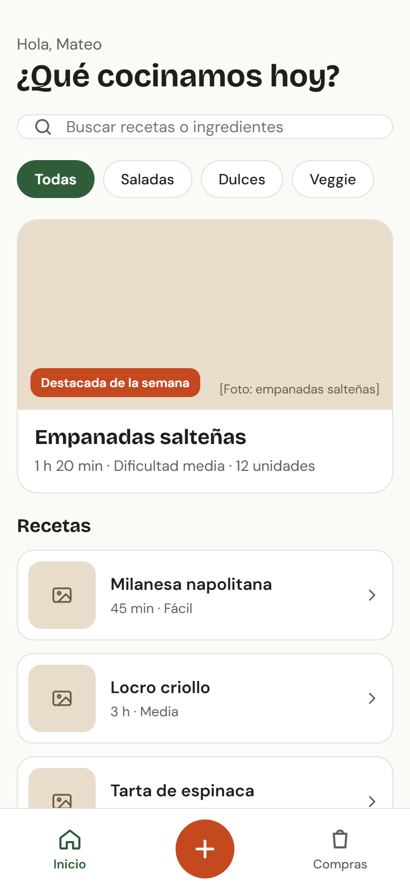
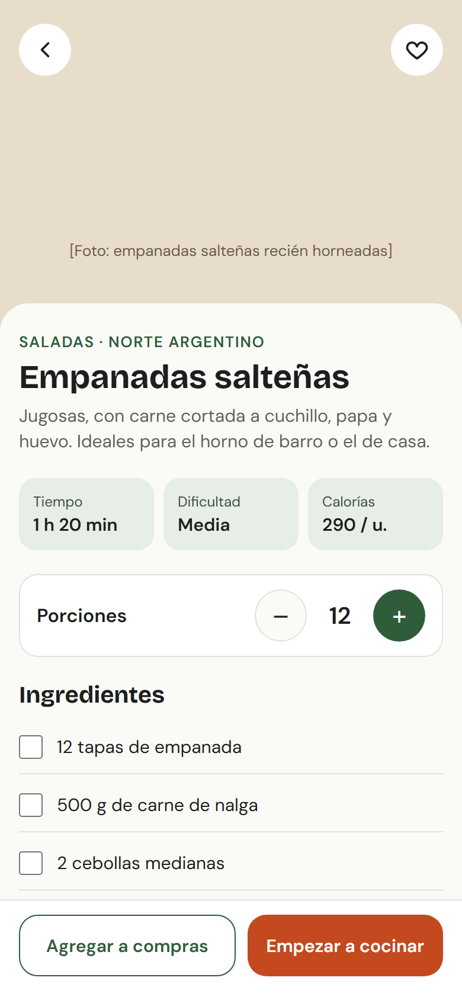
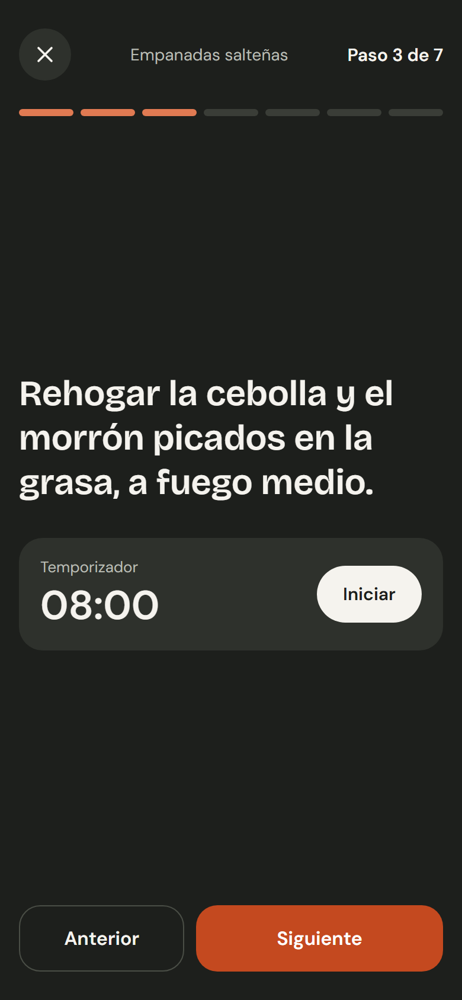
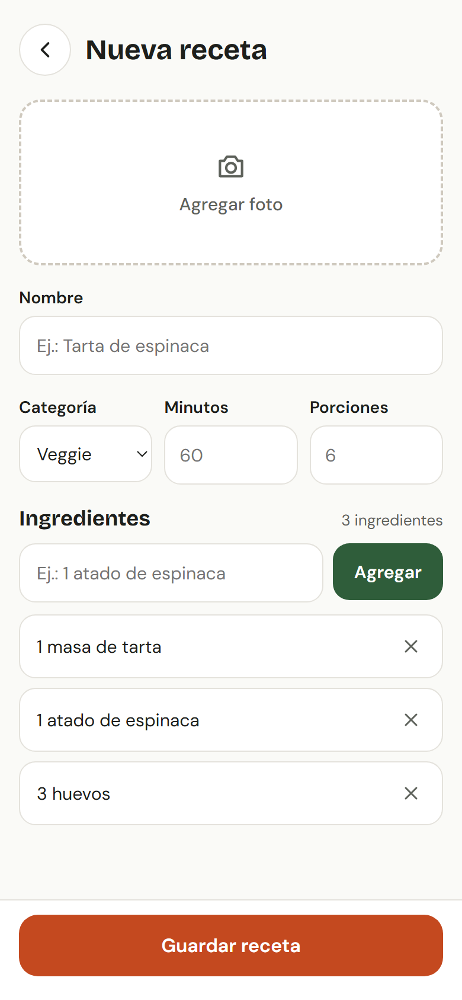
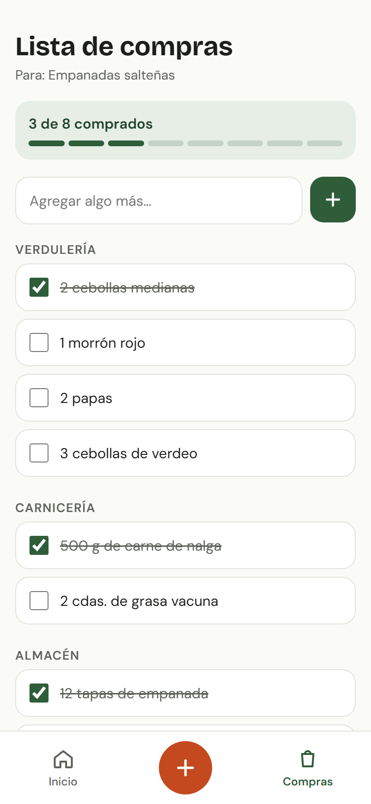

# Fogón

App de recetas para Android (Java). Parcial 1 de Aplicaciones Móviles — ACN4B — Mateo Teggi.

Pantalla desarrollada: **Detalle de receta** (empanadas salteñas), con porciones ajustables, ingredientes tildables, lista de compras, favorito y modo cocina paso a paso.

- Informe con pantallas y flujos: [docs/informe.md](docs/informe.md)
- Mockups de todas las pantallas: [docs/mockups](docs/mockups)

  
  
  
  
  

## Cómo correrla

1. Abrir la carpeta con Android Studio.
2. Esperar la sincronización de Gradle.
3. Ejecutar la configuración `app` en un emulador o dispositivo (Android 7.0+).
